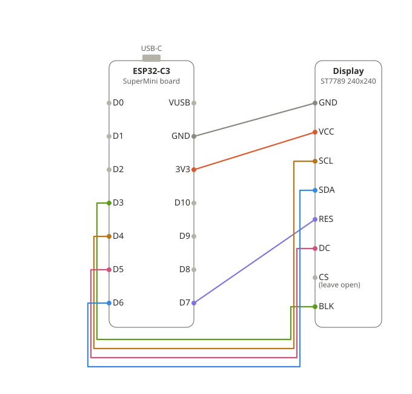

# ESP32-C3 Sports Scoreboard

A small always-on scoreboard for an **ESP32-C3** and a **240x240 ST7789** display.
It cycles through every live game (NFL, NBA, MLB, NHL by default) and keeps each
final score on the rotation for **one hour** after the game ends. No buttons.
Scores come from ESPN's unofficial public scoreboard JSON (no API key).

## Parts

- ESP32-C3 board (ESP32-C3 SuperMini or any C3 dev board with native USB)
- 240x240 ST7789 SPI display module (typically 7 pins: GND, VCC, SCL, SDA, RES, DC, BLK; some also have CS)
- 7 jumper wires and a USB-C cable

## Wiring



| Display pin | ESP32-C3 pin | Notes |
|-------------|--------------|-------|
| GND         | GND          | |
| VCC         | 3V3          | 3.3 V, not 5 V |
| SCL (SCK)   | GPIO4        | SPI clock |
| SDA (MOSI)  | GPIO6        | SPI data; "SDA" here is SPI, not I²C |
| RES (RST)   | GPIO7        | reset |
| DC          | GPIO5        | data/command |
| BLK (LED)   | GPIO3        | backlight on/off. Or wire to 3V3 for always-on |
| CS (if present) | GND      | tie low. Most 240x240 modules have no CS pin |

Pins are set in `platformio.ini` (`-DTFT_SCLK=4` and so on). Change them there if
you wire differently. Avoid GPIO2, 8 and 9 (strapping pins).

## Step by step

1. **Wire it** per the table above.
2. **Install PlatformIO.** Either the VS Code extension, or the CLI:
   ```bash
   uv tool install platformio    # or: pipx install platformio
   ```
3. **Clone and enter the repo:**
   ```bash
   git clone <this repo's URL> esp32-scoreboard
   cd esp32-scoreboard
   ```
4. **Create your config:**
   ```bash
   cp include/config.example.h include/config.h
   ```
   Edit `include/config.h`: set `WIFI_SSID`, `WIFI_PASS` (2.4 GHz WiFi only) and
   `TZ_INFO` (your timezone). Optionally edit the `LEAGUES` list, the hold time
   and the timing values. `config.h` is gitignored so your WiFi password stays local.
5. **Plug in the board** by USB and build and flash:
   ```bash
   pio run -t upload
   ```
   If the board is not detected, hold the **BOOT** button while plugging in
   USB, then run the command again.
6. **Watch the logs** (optional):
   ```bash
   pio device monitor
   ```
   You should see `refresh: N games` every 20 s while a game is live, or every
   5 min when nothing is on.

## How it behaves

- **Live games** show with a green header, score, and period/clock (`Q3 4:12`).
- **Final games** show with a grey header and stay in the rotation for
  `FINAL_HOLD_SECONDS` (default 3600) after the scoreboard first reports them final.
  After a reboot, games that started more than 5 hours earlier are treated as
  already expired (the API has no end time).
- Each game is shown for `CARD_MS` (6 s), then the next one.
- The last card in every rotation shows the **date, time and weather** (current
  temperature, conditions, high/low) from Open-Meteo, no API key. Set `WX_LAT` and
  `WX_LON` in `config.h` to your location, plus `WX_FAHRENHEIT` and `CLOCK_24H`.
  With no games on, this card is the only one shown.
- Polls every 20 s while any game is live and every 5 min otherwise.
- ESPN's scoreboard lists the current day's games, so a final from late night
  may drop off when the day rolls over.

## Troubleshooting

| Symptom | Fix |
|---------|-----|
| Blank white screen | Check VCC/GND, then DC/RES wiring. Try `-DSPI_FREQUENCY=20000000` in `platformio.ini`. |
| Colors look inverted | Remove `-DTFT_INVERSION_ON=1`. |
| Red and blue swapped | Change `-DTFT_RGB_ORDER=TFT_BGR` to `TFT_RGB`. |
| Image shifted or garbage at edges | Your module may be a 240x320 panel. Confirm `TFT_WIDTH`/`TFT_HEIGHT`. |
| Backlight never turns on | Move BLK to 3V3. |
| Won't join WiFi (SuperMini) | Some boards need lower TX power: add `WiFi.setTxPower(WIFI_POWER_8_5dBm);` after `WiFi.mode(WIFI_STA);` in `setup()`. |
| No serial output | `ARDUINO_USB_CDC_ON_BOOT` is on, so use the native USB port and `pio device monitor`. |
| No games ever show | Check the serial log for `HTTP` or `JSON` errors. The ESPN endpoint is unofficial and can change. |

## Notes

- HTTPS uses `setInsecure()` (no certificate check). Fine for public scores, no secrets are sent.
- Add leagues by appending to `LEAGUES`, e.g. `{"soccer/eng.1", "EPL"}`. Labels must be 5 characters or fewer.
